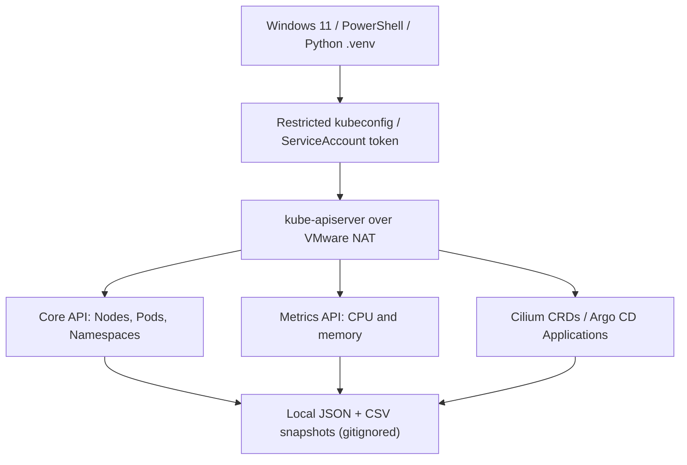

# k8s-observer

[](https://github.com/shm2/k8s-observer/actions/workflows/python-ci.yml)


**A Windows-native Python observability lab for a self-hosted Kubernetes cluster.**

`k8s-observer` uses the official Kubernetes Python client to inspect cluster health, resource availability and usage, Cilium networking components, and Argo CD application state—without installing Kubernetes on the Windows host or writing to cluster workloads.

> **Scope:** Read-only, point-in-time inspection and JSON/CSV reporting. This is a learning/portfolio project, not a replacement for Prometheus, Grafana, Hubble, or a production alerting system.

## What it does

| Stage | Script | Function |
| --- | --- | --- |
| Node discovery | `k8s_observer.py` | Node names, Ready conditions, Kubernetes versions, capacity, and allocatable resources |
| Pod inventory | `k8s_pod_observer.py` | Namespace coverage, Pod readiness, lifecycle phase, container restart history, node placement |
| Resource metrics | `k8s_metrics_observer.py` | Metrics Server CPU/memory readings and top-consuming Pods |
| Platform checks | `k8s_platform_observer.py` | Cilium agents, operator, endpoint/node state; Argo CD workloads and Application sync/health |
| Report export | `k8s_report.py` | Consolidated timestamped JSON snapshot plus node, Pod, namespace, and platform CSVs |
| Unit tests | `tests/test_k8s_report.py` | Offline transformation and export tests using fixtures |

## Lab environment

| Layer | Implementation |
| --- | --- |
| Developer workstation | Dell Inspiron 15, Windows 11, PowerShell, Python 3.14 + `.venv` |
| Virtualization | VMware Workstation Pro (NAT networking) |
| Kubernetes | Three-node Ubuntu 24.04 kubeadm cluster (1 control plane, 2 workers), v1.36.5 in the lab |
| Network and GitOps | Cilium CNI, Argo CD |
| Storage | NFS CSI |
| Authentication | Short-lived ServiceAccount bearer token via a dedicated kubeconfig |
| Authorization | Least-privilege, read-only Kubernetes RBAC |

**Validated first integration:** the Python client successfully returned all three node names and `Ready=True` with Kubernetes `v1.36.5`.

```text
k8scp2   Ready=True   Kubernetes=v1.36.5
k8s-w1   Ready=True   Kubernetes=v1.36.5
k8s-w2   Ready=True   Kubernetes=v1.36.5
```

## Architecture



More details: [Architecture and permission model](docs/ARCHITECTURE.md).

## Quick start (Windows PowerShell)

**Prerequisites:** Python 3.14, Git, network connectivity to a Kubernetes API, and a dedicated **read-only** kubeconfig at `%USERPROFILE%\.kube\k8s-observer-ro.yaml`. The repository deliberately does not contain credentials.

```powershell
# Clone the project
git clone https://github.com/shm2/k8s-observer.git
cd k8s-observer

# Create an isolated Python interpreter environment
py -V:3.14 -m venv .venv

# Install dependencies without changing system Python
.\.venv\Scripts\python.exe -m pip install -r requirements.txt

# Test the report processing logic (no Kubernetes cluster needed)
.\.venv\Scripts\python.exe -m pytest -q

# Collect a live read-only cluster snapshot (requires credentials and a reachable API)
.\.venv\Scripts\python.exe .\k8s_report.py
```

The scripts also run independently:

```powershell
# Nodes, capacity and allocatable resources
.\.venv\Scripts\python.exe .\k8s_observer.py

# Namespace/Pod health, with optional complete inventory
.\.venv\Scripts\python.exe .\k8s_pod_observer.py --all

# Metrics Server utilization
.\.venv\Scripts\python.exe .\k8s_metrics_observer.py

# Cilium + Argo CD overview
.\.venv\Scripts\python.exe .\k8s_platform_observer.py
```

## Report output

`k8s_report.py` creates a UTC-timestamped directory, for example:

```text
reports/
└── 20261116T120000_000000Z/
    ├── snapshot.json       # Consolidated observations + API availability
    ├── nodes.csv           # Capacity, allocatable, node usage
    ├── pods.csv            # Pod health, restarts, Pod usage
    ├── namespaces.csv      # Namespace counts and status totals
    └── platform.csv        # Cilium and Argo CD health checks
```

The timestamp above illustrates the output naming scheme, not a captured real-world report. All generated reports are ignored by Git.

Optional API calls can be unavailable (for example, when Metrics Server or a CRD is absent or RBAC excludes it). The consolidated JSON reports that explicitly in `availability`; absent measurements are **not** converted to zero.

## Tests and CI

```powershell
# Run the seven offline unit tests
.\.venv\Scripts\python.exe -m pytest -v tests\
```

GitHub Actions runs the offline test suite and Python syntax compilation on pushes and pull requests to `main`. The workflow **does not** connect to the private VMware cluster, load a kubeconfig, or deploy anything.

## Security and limitations

- The ServiceAccount is granted **read-only** access to required API resources. No create, patch, delete or Secrets permissions are required.
- Never commit kubeconfig files, bearer tokens, cluster dumps or generated reports. The `.gitignore` excludes the local virtual environment and `reports/`.
- ServiceAccount tokens are short-lived and must be renewed as necessary.
- Kubernetes Pod specifications and inventory reports may still expose sensitive infrastructure details; inspect outputs before sharing.
- `Running` is not synonymous with `Ready`; cumulative restarts are not a restart rate.
- Metrics Server reports recent samples, not a historical observability database.
- Cilium readiness and Argo CD sync state are signals, not proof of full end-to-end application or network health.

## Future improvements

- Configurable output formats, namespaces, and command-line filters.
- Structured exit codes and richer API error handling.
- Time-series comparison between snapshots for restart deltas.
- Better automated validation of platform checks using mocked API responses.
- Optional dashboards and additional metrics backends.

---

**Focus:** Python automation · Kubernetes API · RBAC · Cilium · Argo CD · infrastructure diagnostics · GitHub Actions
